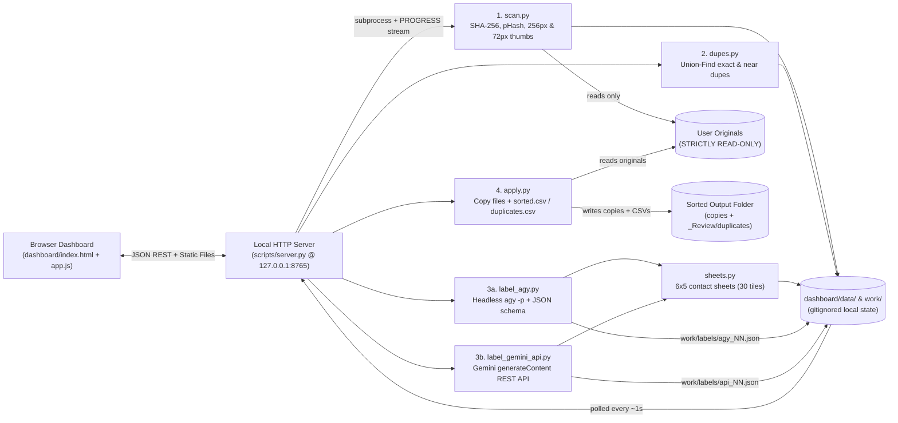

# Gemini Photo Sorter — Architecture & Developer Reference

This document is the complete technical reference for **Gemini Photo Sorter**. It describes every module, API endpoint, data schema, pipeline contract, frontend state machine, and platform-specific design decision so any developer or AI agent can safely extend or debug the project.

---

## 1. System Overview

Gemini Photo Sorter is a **zero-build, localhost-only Python + vanilla JS web application** that sorts a local camera roll into folders using **Antigravity CLI (`agy`)** by default, with **Gemini API** as an optional backup.



### Core Design Principles
1. **Strictly read-only on originals:** Source media is never moved, renamed, or deleted. `apply.py` creates sorted copies (APFS copy-on-write clones via `cp -c -p` on macOS, `shutil.copy2` on Windows/Linux).
2. **Zero frontend build tooling:** Plain HTML, CSS, and ES2020+ JS served directly from `dashboard/` with `Cache-Control: no-store` so edits take effect on refresh.
3. **Minimal Python dependencies:** Only 3 packages in `requirements.txt` (`pillow`, `pillow-heif`, `imagehash`). HTTP serving and Gemini API calls use Python's stdlib (`http.server`, `urllib.request`).
4. **Resumable & streaming:** Contact sheet labeling writes one JSON file per batch (`work/labels/agy_NN.json` or `work/labels/api_NN.json`). Interrupted runs skip already-completed batches; the browser polls `/api/labels` to fly thumbnails into folders live as batches finish.
5. **Localhost-only security:** `server.py` binds exclusively to `127.0.0.1` and enforces `Origin` checks on all `POST` endpoints.

---

## 2. Repository Layout

```text
.
├── categories.json             # Editable folder definitions (key, kind, label, emoji, rule)
├── requirements.txt            # Python deps: pillow, pillow-heif, imagehash
├── .gitignore                  # Excludes .venv/, .env, work/, dashboard/data|peek|demo/
├── AGENTS.md                   # Operating rules, playbooks, gotchas & verification steps for AI agents
├── README.md                   # User-facing quick start and overview
├── docs/
│   └── ARCHITECTURE.md         # This technical reference
├── setup.bat / start.bat       # Windows setup & launch scripts
├── Open Photo Sorter.bat       # Double-click Windows launcher
├── setup.sh / start.sh         # macOS / Linux setup & launch scripts
├── Open Photo Sorter.command   # Double-click macOS launcher
├── dashboard/                  # Static frontend served at http://127.0.0.1:8765/
│   ├── index.html              # Page shell, KPI bar, 3-column board, sphere/fly/confetti layers
│   ├── tokens.css              # Dark/light tone ramp and Gemini cobalt/indigo accent tokens
│   ├── components.css          # Reusable buttons, KPI grid, dialogs, segmented controls
│   ├── app.css                 # Layout, folder cards, 3D stage, folder picker modal, lightbox
│   └── app.js                  # State machine, 3D Fibonacci sphere, flight animations, API client
├── scripts/                    # Python backend & pipeline CLI scripts
│   ├── common.py               # Shared paths, UTF-8 JSON I/O, .env key helpers, agy locator
│   ├── server.py               # ThreadingHTTPServer, job runner, folder browser, file streaming
│   ├── scan.py                 # Step 1: media discovery, SHA-256, pHash, thumbnails, Takeout sidecars
│   ├── dupes.py                # Step 2: Union-Find exact + near-duplicate grouping & preview sheet
│   ├── sheets.py               # Contact sheet generator (6x5 grid, yellow ID/VIDEO/PNG badges)
│   ├── label_agy.py            # Step 3 (primary): headless Antigravity CLI batch labeler
│   ├── label_gemini_api.py     # Step 3 (backup): direct Gemini REST API batch labeler + --estimate
│   ├── apply.py                # Step 4: merge labels + overrides, copy files, write CSV manifests
│   └── demo.py                 # Generates 1,057 synthetic thumbnails + JSON into dashboard/demo/
│
│   # Generated at runtime (ALL gitignored, never commit):
├── .venv/                      # Python 3.12 virtual environment
├── .env                        # Optional backup GEMINI_API_KEY
├── dashboard/
│   ├── data/                   # Active scan state: inventory.json, dupes.json, labels.json, source.json, thumbs/, mini/
│   ├── peek/                   # Up to 60 tiny 64px setup-sphere thumbnails from /api/peek
│   └── demo/                   # Synthetic demo dataset generated by scripts/demo.py
└── work/                       # Scratch workspace for labeling
    ├── sheets/                 # 6x5 contact sheets: sheet_00.jpg, sheet_01.jpg, ...
    ├── sample/                 # Optional 3-sheet random sample (sheets.py --sample)
    ├── labels/                 # Cached batch outputs (agy_00.json / api_00.json) + .categories marker
    ├── label_schema.json       # JSON schema passed to `agy --json-schema`
    ├── overrides.json          # Manual user re-categorizations made in the dashboard lightbox
    ├── duplicates.jpg          # Visual contact sheet of detected duplicate groups
    └── agy_failed_NN.txt       # Raw stdout/stderr dumps when a batch attempt fails
```

---

## 3. Pipeline Stages & Contracts

### Progress Streaming Protocol
`server.py` runs each pipeline script as a UTF-8 subprocess (`PYTHONUTF8=1`, `PYTHONIOENCODING=utf-8`) via `stream(cmd)` and parses stdout line-by-line:
- Any line matching `^PROGRESS (\d+) (\d+)$` updates `job["done"]` and `job["total"]` in memory (not appended to `job["log"]`).
- All other lines are appended to `job["log"]` (the last 40 lines are returned by `/api/state`).
- Always pass `flush=True` on `print(...)` calls in pipeline scripts (and `server.py` runs Python with `-u`).

### Stage 1: `scripts/scan.py`
- **CLI:** `python scripts/scan.py "<source_folder>" [--limit N]`
- **Skips:** directories starting with `.` or ending with ` (sorted)`; files starting with `._`.
- **Supported extensions (`common.py`):**
  - `IMG`: `.jpg`, `.jpeg`, `.png`, `.heic`, `.heif`, `.webp`, `.gif`, `.bmp`, `.tif`, `.tiff`
  - `VID`: `.mov`, `.mp4`, `.m4v`, `.3gp`, `.avi`, `.mkv`, `.webm`
- **Concurrency:** `ThreadPoolExecutor(8)`.
- **Per-file work:**
  1. Computes streaming `sha256` (1 MB chunks).
  2. Photos: opens with Pillow (`pillow-heif` registered if installed), applies EXIF transpose, center-crops to square, writes `dashboard/data/thumbs/{id}.jpg` (256px) and `dashboard/data/mini/{id}.jpg` (72px).
  3. Videos: if `ffmpeg` + `ffprobe` are on `PATH`, extracts frame at `1s` (or `0s` if duration <= 2s) and reads width/height/rotation/duration. Otherwise generates a `(52, 58, 72)` placeholder thumbnail.
  4. Computes `imagehash.phash()` on the 256px thumbnail.
  5. Looks for Google Takeout `.json` sidecars (`<name>.json`, `<name>.supplemental-metadata.json`, and numbered `IMG_1(1).JPG` variants) to extract `taken` (Unix timestamp) and `geo` (`[lat, lon]`).
- **Outputs:** `dashboard/data/inventory.json`, `dashboard/data/source.json`.

### Stage 2: `scripts/dupes.py`
- **CLI:** `python scripts/dupes.py`
- **Algorithm:**
  1. Union-Find over all inventory IDs.
  2. Exact duplicates: identical `sha256` are unioned immediately.
  3. Near duplicates: pairwise compare items of the same `kind` (`photo` vs `video`) with `phash` Hamming distance `<= 4`.
  4. **PNG screenshot guard:** if both files are `.png` with different `sha256`, compute grayscale pixel difference on their 256px thumbnails; reject match if `> 0.4%` of pixels differ by `> 40` intensity levels. This prevents distinct screenshots of the same app UI from being falsely flagged as duplicates.
  5. Keeper selection per group: sort by `(-bytes, len(name))` so the largest file (and cleanest filename) is kept; remaining IDs go into `dupes`.
- **Outputs:** `dashboard/data/dupes.json` and visual check sheet `work/duplicates.jpg` (up to 60 groups, 8 columns).

### Stage 3A (Primary): `scripts/label_agy.py`
- **CLI:** `python scripts/label_agy.py [--only N] [--model <slug>]`
- **Env vars:** `AGY_WORKERS` (default `3`), `AGY_MODEL` (optional slug; omit to use user's default `agy` model).
- **Flow:**
  1. Locates `agy` via `common.find_agy()` (`PATH`, `%LOCALAPPDATA%\agy\bin\agy.exe`, `~/.local/bin/agy`, `/usr/local/bin/agy`, `/opt/homebrew/bin/agy`).
  2. Generates contact sheets via `scripts/sheets.py` if `work/sheets/sheet_*.jpg` do not exist.
  3. Writes `work/label_schema.json`:
     ```json
     {
       "type": "object",
       "properties": {
         "labels": {
           "type": "array",
           "items": {
             "type": "object",
             "properties": {
               "id": { "type": "string" },
               "key": { "type": "string" }
             },
             "required": ["id", "key"]
           }
         }
       },
       "required": ["labels"]
     }
     ```
     > **Why an array instead of a map?** Gemini structured output schemas reject empty `properties: {}` with `additionalProperties`. Using `labels: [{id, key}]` is 100% schema-compliant and parsed via `extract_labels()`, which also supports flat `{"id": "key"}` text fallbacks.
  4. Groups 3 sheets (~90 files) per batch and invokes:
     ```text
     agy -p <prompt> --output-format json --json-schema <work/label_schema.json>
         --disable-slash-commands --print-timeout 15m --add-dir <work> [--model <slug>]
     ```
     with `cwd=WORK` and absolute paths to the contact sheets.
  5. Accepts a batch if `>= 90%` of expected IDs received valid category keys; retries up to 4 times with linear backoff (`8s * attempt`), writing debug logs to `work/agy_failed_NN.txt` on failure.
  6. Saves accepted batch to `work/labels/agy_NN.json`. Already-complete batches are skipped (`cached`).

### Stage 3B (Backup): `scripts/label_gemini_api.py`
- **CLI:** `python scripts/label_gemini_api.py [--estimate] [--only N] [--model <model>]`
- **Env vars:** `GEMINI_API_KEY` (or `GOOGLE_API_KEY`, also read from `.env`), `GEMINI_MODEL` (default `gemini-2.5-flash`), `GEMINI_WORKERS` (default `4`).
- **Estimate mode (`--estimate`):** Makes zero network calls; estimates `sheets * 1200` tokens.
- **Live mode:** Sends 3 base64-encoded contact sheet JPEGs as `inlineData` parts to `https://generativelanguage.googleapis.com/v1beta/models/{model}:generateContent` with `temperature: 0.1`, `responseMimeType: "application/json"`, and `responseSchema`. Retries transient errors (`429`/`5xx`) with exponential backoff; aborts immediately on `400`/`401`/`403`. Saves to `work/labels/api_NN.json`.

### Stage 4: `scripts/apply.py`
- **CLI:** `python scripts/apply.py "<output_folder>"`
- **Safety checks:** Refuses to write inside the source folder (prevents recursive re-scanning).
- **Label resolution order:**
  1. Merges all `work/labels/*.json` in sorted filename order.
  2. Enforces kind matching (`photo` files only in `photo` categories; `video` files only in `video` categories). Missing or mismatched labels fall back to the **last category of that kind** (catch-all).
  3. Applies manual dashboard overrides from `work/overrides.json` last (user always wins).
- **Idempotent rebuilds:** If `<dest>/sorted.csv` already exists, removes **only** the previously copied files listed in that CSV and prunes empty folders before copying fresh results.
- **Filename safety & collisions:** Sanitizes folder names for Windows/macOS (`&` → `and`, strips `/ \ : * ? " < > |`). Duplicate filenames from different source subdirectories are disambiguated as `<stem>__<id><ext>`.
- **Outputs:**
  - `dashboard/data/labels.json`, `dashboard/data/categories.json`, updates `source.json["sorted"]`
  - `<dest>/<Folder Name>/<file>` and `<dest>/_Review/duplicates/<file>`
  - `<dest>/sorted.csv` (`file,folder,original_path`)
  - `<dest>/duplicates.csv` (`duplicate,kept_copy,type,duplicate_path,kept_path`)

---

## 4. HTTP API Reference (`scripts/server.py`)

Base URL: `http://127.0.0.1:8765` (configurable via `PORT` env var).
All `POST` endpoints validate that the `Origin` header (when present) matches `http://127.0.0.1:{PORT}` or `http://localhost:{PORT}` (otherwise `403`). Error responses return `{"error": "<message>"}` with HTTP `400` or `404`.

### `GET` Endpoints

| Endpoint | Response | Description |
|---|---|---|
| `GET /` & static files | HTML/CSS/JS/JPG | Serves `dashboard/` with `Cache-Control: no-store` on code, `/data/`, and `/peek/`. |
| `GET /api/state` | State JSON | Full app state: `categories`, `source`, `limit`, `sorted`, `files`, `bytes`, `steps`, `agy_cli`, `gemini_key`, `overrides`, `job`, `platform`, `can_pick` (`true`), `native_pick` (bool). |
| `GET /api/labels` | `{"0": "food", ...}` | Merged live labels from all `work/labels/*.json` files currently on disk. |
| `GET /api/browse?path=<dir>` | Browse JSON | Lists `path`, `parent`, `dirs` (`[{name, path}]`), direct `photos`/`videos` counts, and OS `places` (Pictures, Desktop, Downloads, Documents, OneDrive, Home, Drives) for the in-browser folder picker. |
| `GET /api/file/<id>` | Binary image/video | Streams original file from `inventory.json` with HTTP `Range` (`206`) support for video scrubbing. Converts `.heic/.heif/.tif/.tiff/.bmp` on-the-fly to max-2400px JPEG. Maps `.mov` to `video/mp4`. |

### `POST` Endpoints

| Endpoint | Request Body | Behavior & Response |
|---|---|---|
| `POST /api/peek` | `{"source": "<path>"}` | Walks folder, counts photos/videos/bytes, generates up to 60 square 64px previews in `dashboard/peek/`, returns `{source, photos, videos, bytes, previews, suggested_dest}`. |
| `POST /api/sort` | `{"source", "dest", "labeler": "agy"\|"gemini_api", "model": "", "limit": 0}` | Starts full background job (`[scan] -> dupes -> label -> apply`). Skips `scan` if `source` and `limit` match existing `source.json`. Invalidates `work/labels/` if `categories.json` SHA-1 fingerprint changed. Returns `state()`. |
| `POST /api/run` | `{"step": "scan"\|"dupes"\|"estimate"\|"agy"\|"gemini_api"\|"apply", ...}` | Runs a single pipeline script in the background. Returns `state()`. |
| `POST /api/categories` | `{"categories": [...]}` | Validates unique keys, non-empty labels, and >=1 photo + >=1 video folder; saves `categories.json` and `dashboard/data/categories.json`. Returns `state()`. |
| `POST /api/move` | `{"id": 12, "key": "travel"}` | Saves manual override in `work/overrides.json` and immediately updates `dashboard/data/labels.json`. Returns `state()`. |
| `POST /api/key` | `{"key": "<api_key>"}` | Writes/updates `GEMINI_API_KEY` in local `.env` (never returned in plaintext). Returns `state()`. |
| `POST /api/mkdir` | `{"parent": "<dir>", "name": "<name>"}` | Creates a subfolder safely inside `parent` for the in-browser folder picker. Returns `{"path": "<created>"}`. |
| `POST /api/pick` | `{"prompt": "<title>"}` | Opens native OS folder picker (Windows `tkinter` + PowerShell 5.1 fallback, macOS `osascript`, Linux `zenity`/`kdialog`). Only exposed in UI when `native_pick` is `true`. Returns `{"path": "<path>"\|null}`. |
| `POST /api/open` | `{"id": 12}` or `{"folder": "Selfies"}` or `{}` | Reveals original file or opens sorted folder in Explorer / Finder / xdg-open. Returns `state()`. |

---

## 5. Data Schemas on Disk

- **`categories.json`** — Array of folder objects. **The last folder of each `kind` acts as the catch-all fallback.**
  ```json
  { "key": "food", "kind": "photo", "label": "Food & drinks", "emoji": "🍜", "rule": "meals, snacks, drinks, cafes, the food is the subject" }
  ```
- **`dashboard/data/inventory.json`** — Array of file records:
  ```json
  { "id": 0, "path": "C:\\...", "name": "IMG_001.JPG", "ext": ".jpg", "kind": "photo", "bytes": 2418200, "sha256": "...", "w": 4032, "h": 3024, "phash": "c394...", "taken": 1700000000, "geo": [37.7, -122.4] }
  ```
- **`dashboard/data/dupes.json`** — Array of duplicate groups:
  ```json
  { "keep": 4, "dupes": [5, 6], "type": "exact", "freed": 4836400 }
  ```
- **`dashboard/data/labels.json`** & **`work/labels/*.json`** — Flat map `{"<id>": "<category_key>"}`.
- **`dashboard/data/source.json`** — `{"source": "<abs_path>", "limit": 0, "sorted": "<abs_dest_path>"}`.

---

## 6. Frontend Architecture (`dashboard/`)

### URL Query Parameters
- `?demo` — Loads static synthetic dataset from `dashboard/demo/` (disables mutating API calls).
- `?d=20` — Sets replay animation duration in seconds (default `12`).
- `?auto` — Auto-starts replay 1.2s after load when in `done` mode.
- `?source=<path>&dest=<path>` — Pre-fills source and destination folders in setup mode.

### State Machine (`dashboard/app.js`)
`mode` transitions through three states (`document.body.dataset.mode`):
1. **`setup`** — Shows the 3-step setup card in the center stage (1. Choose photos → triggers `/api/peek` and populates a 60-tile preview sphere; 2. Choose destination; 3. Start sorting + expandable **Advanced** panel for folder chips, Antigravity CLI vs Gemini API selection, model dropdown, inline API key saver, and 200-file sample toggle).
2. **`running`** — Polls `/api/state` every 900ms and `/api/labels` every 1200ms. Once `scan` finishes, swaps the preview sphere for the real inventory (`sphereFromItems()`). Newly arrived labels are pushed into `queue[]` and released smoothly (`ceil(queue.length / 45)` per frame) so photos arc out of the 3D sphere into their destination folder cards.
3. **`done`** — Shows completion summary + confetti, enables folder browsing (120 items per page), full-size lightbox (`ArrowLeft`/`ArrowRight`/`Escape`, video playback, "Move to" dropdown, "Show original"), **New sort**, **Open sorted folder**, and **Replay** (`Space` or top-right button).

### 3D Sphere & Animation Loop
- `buildSphere()` distributes up to 320 `72px` thumbnails evenly on a unit sphere using the golden angle (`π * (3 - √5)`).
- `tick()` runs via `requestAnimationFrame`, rotating the sphere smoothly with subtle sine tilt and depth-based scale/opacity/`zIndex`.
- `release(item)` animates a flying `` via the Web Animations API (`img.animate(...)`) along a randomized quadratic-like midpoint arc into the target folder card's thumbnail grid slot, triggering a `.hit` border glow and `.pop` counter animation on landing.

### Platform & Desktop Isolation Notes (Windows)
- `is_interactive_desktop()` in `scripts/server.py` calls Win32 `GetUserObjectInformationW(GetThreadDesktop(...), UOI_NAME)` to detect whether `server.py` is running on the user's visible `"Default"` desktop vs. a hidden headless/agent desktop (e.g., `exebox-...`).
- Because OS file dialogs launched from an isolated desktop are invisible to the user, **Choose folder** opens the built-in in-browser Folder Browser modal (`/api/browse` + `/api/mkdir`) by default, and additionally displays an **OS dialog** button when `native_pick` is `true`.
